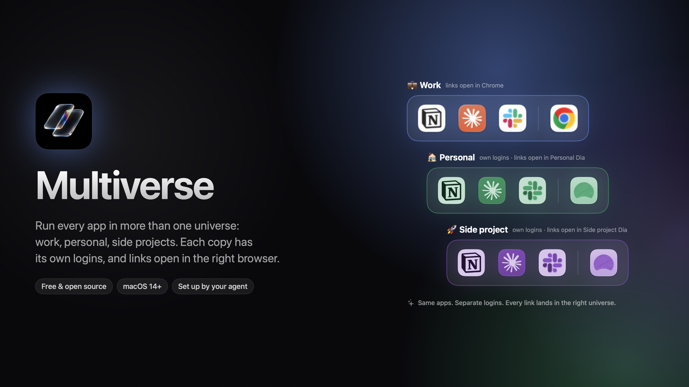

<p align="center"></p>

# Multiverse

**[Watch the 32-second launch film](docs/multiverse-launch.mp4)**

Keep work and personal apart on one Mac, even inside the same app.

Multiverse is a small menu bar app. You make **universes** (say 💼 Work and 🏠 Personal), put apps
in them, and:

- **Copies of the same app live side by side.** A "Work Slack" next to your personal Slack, a
  second Notion for a side project. Each copy has its own name, its own Dock icon (tinted in the
  universe's colour, if you like) and, for apps that support it, its own logins.
- **Links open in the right browser.** A link you click in a work app opens in your work browser.
  A link from a personal app opens in your personal browser. That can be a separate profile of the
  same browser, which Settings → "Make a separate browser" sets up for you.

macOS has one default browser for everything. Multiverse becomes that default browser, looks at
which app the link came from, and passes it on.

## Install with your coding agent (easiest)

No Apple developer account or certificates needed. Multiverse builds on your Mac and signs itself
for your Mac only. Paste this into Claude Code, Codex, Cursor or a similar agent:

> Install and set up Multiverse for me by following
> https://github.com/0xcen/multiverse/blob/main/AGENTS.md. Ask me how I want to split work and
> personal apps and browsers, then configure it, create the copies, and turn on link routing.

The agent will ask which universes you want, which browser each should use, and which apps go where.
It writes the config, builds the copies, and asks you to confirm the default-browser dialog.

## Install by hand

Needs macOS 14+ and Xcode's command line tools (`xcode-select --install`).

```bash
git clone https://github.com/0xcen/multiverse && cd multiverse
./build.sh install
```

Then open Multiverse from the menu bar → **Settings…**, create your universes, and click
**Turn on** so links start being routed. macOS asks you to confirm the browser change.

## How it works

### Copies

A copy is an APFS clone of the original app, so it takes almost no extra disk space. Multiverse
changes the clone's name, bundle id and icon, then signs it again for this Mac. The original app is
never touched.

- **Separate logins:** Electron apps (Slack, Notion, Cursor, Discord…) and Chromium browsers
  (Chrome, Brave, Edge, Arc, Dia…) can keep their data in a different folder. The copy starts
  itself with its own folder in `~/Library/Application Support/Multiverse/<name>`, so you sign in
  to it separately. Other apps share logins with the original, and Multiverse tells you so before
  you create the copy.
- **Keychain prompt:** the first time a copy of a Chromium or Electron app opens, macOS asks whether
  it may use "<App> Safe Storage" from your keychain. That item holds the key the app uses to
  encrypt saved passwords and cookies, and macOS only trusts the original app with it. Enter your Mac
  password and click **Always Allow**. If you click Deny, the copy can't keep you signed in. The
  prompt comes back after a copy is updated, because updating re-signs it.
- **Updates:** a copy doesn't follow the original's auto-updates. When the original updates,
  Multiverse shows "Update" next to the copy. Updating rebuilds the app files only. Logins and data
  live in `~/Library`, not inside the app, so they are kept.
- **Safety:** every app Multiverse builds carries a marker with the id of its entry, and Multiverse
  only ever replaces or trashes a bundle carrying that exact marker. If a name is already taken, it
  asks for another one. Names can't contain `/` or `:`, or start with a dot. The new copy is built next to the old one first, and the
  old one goes to the Trash only once the new one is ready.
- **Signing trade-off:** copies are re-signed for your Mac only ("ad hoc"), without the original's
  hardened runtime, because the hardened runtime would refuse to load the original developer's
  frameworks into an ad-hoc-signed app. That makes a copy easier for other software already running as
  you to tamper with than the original. Only copy apps you'd trust that way.
- **Browsers:** a copy of a browser keeps the original's bundle id, because some browsers (Dia, for
  one) refuse to start under a different one. Multiverse tells the copy and the original apart by
  location. They also share the browser's macOS preferences file, but not their profiles.
- **Not supported:** Apple's built-in apps in `/System`, because macOS won't launch re-signed
  system apps. Some features tied to the original developer's signature may not work in a copy
  (for example iCloud, push notifications or keychain sharing).

### Link routing

When a link arrives, Multiverse asks macOS which process sent it. It matches that process to an app
in one of your universes. It goes by the app's location, its bundle id, and for second profiles the
`--user-data-dir` it was started with. Links from apps outside any universe go to the default one
(★).

If a universe's browser is a Chromium profile (`--user-data-dir`), Multiverse hands the link
straight to that running profile with an Apple Event. Passing it on the command line doesn't work
when the browser is already open. macOS may ask once whether Multiverse may control that browser.

Every routed link is logged, with the sending app and the link's host but never the full URL, to
`~/Library/Logs/Multiverse.log`. The log trims itself past about 1 MB. Only http and https links are
routed; anything else is ignored. The last few routed links appear under **Recent links** in the
menu.

### Command line

The same app is also a command-line tool. Agents use it, and it's handy for scripts:

```bash
M=/Applications/Multiverse.app/Contents/MacOS/Multiverse
$M status                 # universes, apps, what needs creating or updating, routing on/off
$M check                  # validate the config
$M build "Work Slack"     # create or update one copy
$M build --all            # create missing copies, update copies of updated apps
$M make-default-browser   # macOS asks you to confirm
```

The menu bar app reloads `config.json` as soon as it changes, so you can also edit the file by hand.

### Files

| What | Where |
| --- | --- |
| Settings | `~/Library/Application Support/Multiverse/config.json` |
| Copies' data | `~/Library/Application Support/Multiverse/<copy name>/` |
| Log | `~/Library/Logs/Multiverse.log` |

## Uninstall

First pick another default browser in System Settings → Desktop & Dock, otherwise links have
nowhere to go. Then delete
`/Applications/Multiverse.app` and any copies you no longer want. Their data folders are listed
above.

## License

MIT
